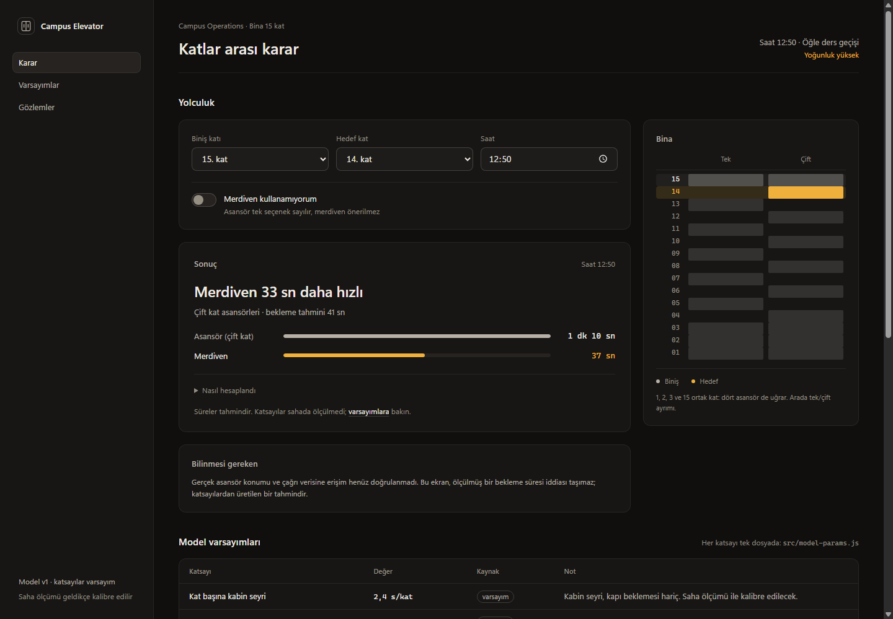
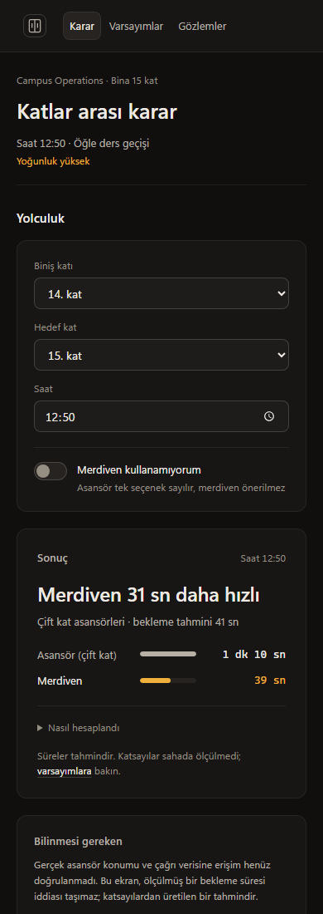

# Campus Elevator Mobility

15 katlı kampüs binasında **hangi asansör grubunun** (tek/çift) çalıştığını ve o anda
**asansör ile merdiven arasındaki süre farkını** gösteren karar aracı. Hedef kullanıcı,
ders aralarında kat değiştiren öğrenciler; erişilebilirlik ihtiyacı olan kullanıcılar
merdiven seçeneğini tamamen kapatabiliyor.

> **Dürüstlük notu:** Bu sürümdeki tüm süreler *tahmindir*. Asansör sisteminden gerçek
> konum/çağrı verisi alınamıyor; katsayılar ölçülmedi. Her katsayı
> `src/model-params.js` içinde `varsayım` etiketiyle durur ve arayüzde görünür.






## Hızlı başlangıç

**Kurulum yok.** `index.html` dosyasını çift tıklayın; tarayıcıda açılır.
Modül, derleme veya sunucu gerekmez: sayfa beş klasik script ve bir stil dosyası yükler,
tümü `file://` üzerinden çalışır.

Testler (bağımlılık yok):

```bash
node --test
node --test --test-isolation=none   # alt süreç açamayan kısıtlı ortamlar için
```

İsterseniz aynı sayfayı yerel sunucuyla da açabilirsiniz:

```bash
node tools/serve.mjs        # → http://127.0.0.1:4173
```

Gereken tek şey **Node.js 20+**. `npm install` adımı yoktur: projenin hiçbir bağımlılığı
yoktur. (Bu tercih, "başka bilgisayarda çalışmıyor" sınıfındaki ortam hatalarını önlemek için.)

## Ne yapar

1. **Karar ekranı** — biniş katı, hedef kat, saat ve "merdiven kullanamıyorum" anahtarı.
   Sonuç: öneri, gerekçe, iki seçeneğin süresi, yoğunluk etiketi, "nasıl hesaplandı" dökümü.
2. **Bina şaftı** — 15 kat, tek/çift asansör şeritleri, biniş ve hedef kat vurgusu.
3. **Varsayım paneli** — kullanılan her katsayı, değeri, kaynak etiketi (`varsayım`).
4. **Gözlem kaydı** — gerçek bekleme süresini saniye ile kaydedip CSV indirme
   (tarayıcıda `localStorage`; sunucu yok). Modelin kalibrasyon verisi buradan çıkar.

Kapsam ve kapsam dışı maddeler: [`docs/mvp-scope.md`](docs/mvp-scope.md).

## Klasör düzeni

```
index.html              tek sayfa, üç bölüm (Karar · Varsayımlar · Gözlemler)
                        beş klasik script yükler → çift tıkla açılır
src/model-params.js     tüm katsayılar (tek doğruluk kaynağı)
src/model.js            bekleme modeli, süreler, karar kuralı (saf fonksiyonlar)
src/present.js          metin ve biçim yardımcıları
src/evidence.js         gözlem doğrulama, CSV, depolama (yedekli)
src/app.js              DOM bağlantıları, bölüm vurgusu
src/styles.css          grafit + amber, 4px ızgara
tools/serve.mjs         isteğe bağlı statik sunucu (file:// zaten çalışır)
tests/                  117 otomatik test (model, sunum, kanıt, tutarlılık, sözleşme, kontrast, yükleme)
docs/                   plan, kapsam, model notları, test planı ve raporu
prompts/                prompt paketi v1→v2 ve değişiklik günlüğü
evidence/               prompt logu, ölçüm şablonu
```

Script'ler `globalThis.CEM` ad alanına yazar; testler aynı dosyaları `tests/setup.js`
üzerinden yükler, yani **kopya kod yoktur** — tek doğruluk kaynağı `src/`.

## Bina kuralı

- **1 = zemin kat.** Dört asansör de **1, 2, 3 ve 15**'e uğrar (ortak katlar); 15. kata
  hem tek hem çift asansör çıkabilir.
- Aradaki katlarda **tek katlar tek asansörlere, çift katlar çift asansörlere**.
- Bu yüzden 3'ten 2'ye, 2'den 7'ye, 14'ten 15'e doğrudan gidilir; **aktarma** yalnızca
  iki kat da 4–14 arasında ve farklı grupta olduğunda gerekir (ör. 5 → 6 için 3. kat,
  14 → 13 için 15. kat).

## Model, kısaca

```
bekleme ≈ (tur süresi / 2) + kuyruk payı
tur     ≈ 2 × (grubun en üst katı − 1) × kat_seyrİ + durak × (kapı + binme)
doğrudan = bekleme + seyir + kat içi yürüme
aktarma  = bekleme₁ + seyir₁ + hol yürümesi + bekleme₂ + seyir₂ + kat içi yürüme
merdiven = kat × merdiven_hızı + hol + kat içi yürüme
```

Karar: erişilebilirlik modunda merdiven hiç hesaplanmaz; fark 12 saniyenin altındaysa
"başabaş" denir. Ayrıntı ve örnek çıktılar: [`docs/model-notes.md`](docs/model-notes.md).

## Test

- 117 otomatik test, 0 bağımlılık, `node --test`. Kontrast (WCAG AA) ve `file://` yüklemesi de test edilir.
- Kapsam: model sınırları, ortak kat kuralı, aktarma planı, 15×15×3 tam tarama,
  erişilebilirlik kuralı, CSV kaçırma, kod ↔ doküman ↔ HTML tutarlılığı, emoji/ünlem
  yasağı, CSS kural seti.
- Sonuç: [`docs/test-report.md`](docs/test-report.md), ham çıktı: [`docs/test-output.txt`](docs/test-output.txt).
- Manuel UAT kiti: [`docs/uat-report.md`](docs/uat-report.md).

## Ekip ve süreç

Campus Operations — Team 00: Ege KURNAZ, Emre YILMAZ, Fatih ELAGÖZ, Eyüp Efe COŞKUN.

Süreç: Scrum-inspired, iki haftalık sprint, Kanban board, PR review, Definition of Done.
Ayrıntı: [`docs/mvp-plan.md`](docs/mvp-plan.md).

## AI Usage Record

- AI Tool(s): DeepSeek Harness (deepseek-v4.1-flash), Claude/GPT tabanlı yardımcılar
- AI Role: Kod iskeleti, test üretimi, doküman taslağı, arayüz yönü önerisi
- Human Review: Completed
- Final Decision: Team
- Prompt kayıtları: `prompts/CHANGELOG.md` ve `evidence/prompt-log.md`

Arayüz yönü ve tasarım geçişleri, Damir Sokolovsky'nin **unslop** skill'i ile
(CC BY 4.0) çalışıldı; üretilen kod bu projeye aittir.

